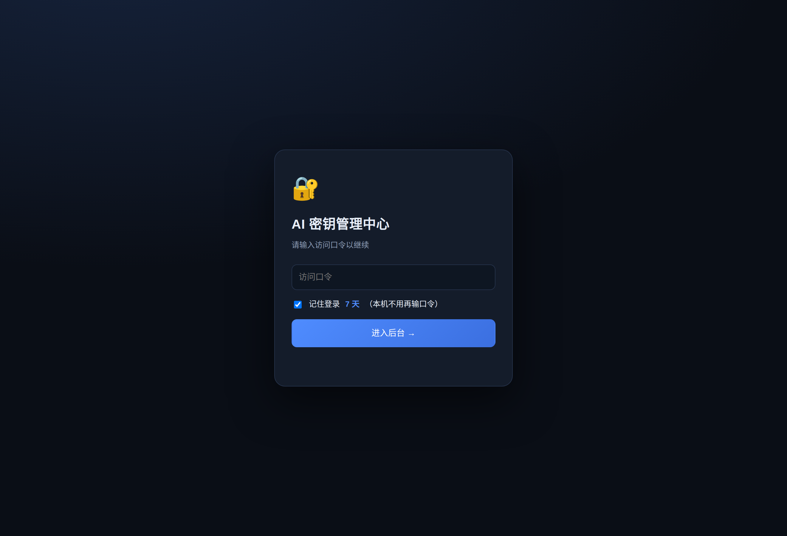
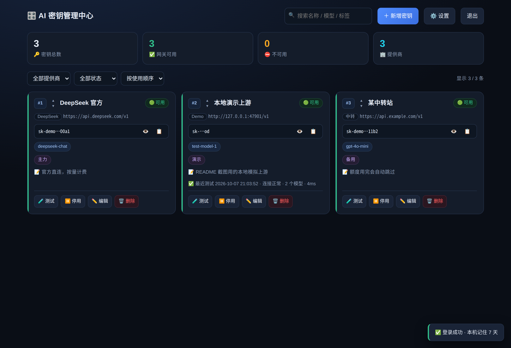
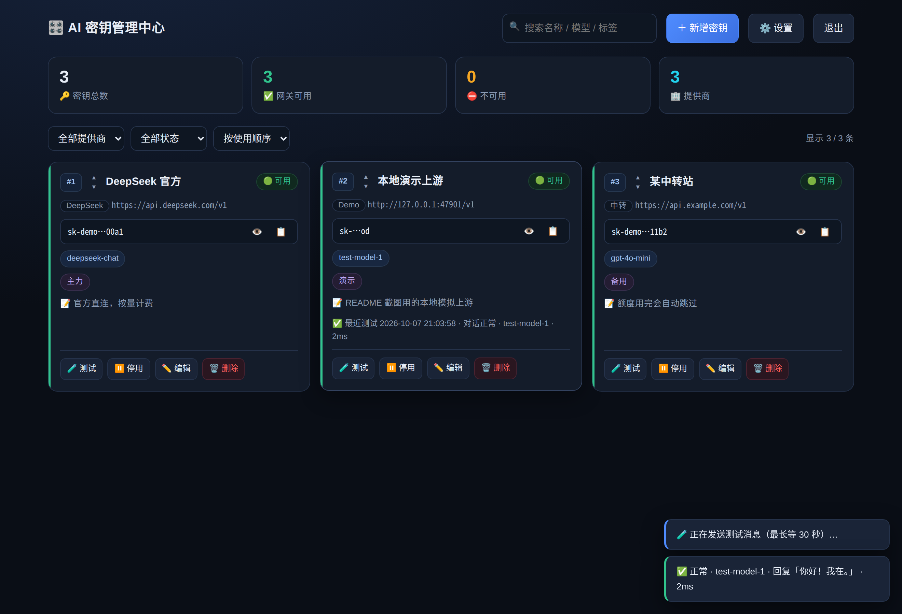
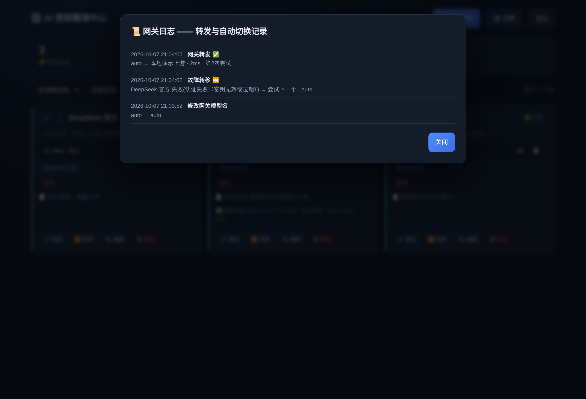

# AI 密钥网关 · AI API Key Hub

> 把你手上散落各处的 AI 服务商 API Key 合成 **一个** OpenAI 兼容入口。
> 按顺序自动使用，**欠费 / 限速 / 失效的会自动跳过** —— 客户端完全感觉不到。

**纯 Python 标准库 · 零第三方依赖 · 零 pip 安装 · 零 CDN · 单文件后端**


**English**: A self-hosted, OpenAI-compatible API gateway written in pure Python stdlib (zero dependencies).
Import your multiple AI provider keys, and it automatically fails over on quota / rate-limit / auth errors,
so your client always gets an answer. Password-gated admin panel included.

---

## 📖 这是什么

你有没有这样的时候：

- 手上有 **3～5 家** AI 服务商的 Key（官方、中转、免费额度……），各有各的额度和限速
- 客户端（Cherry Studio / NextChat / Cursor / one-api / 自己写的脚本）要一家一家配，烦
- 某家突然**欠费 / 限速 / Key 失效**，程序直接报错，你还得手动去换

**这个项目就是为了解决这个。** 它在中间加一层网关：

```
你的客户端 ──► AI 密钥网关 ──► ① 服务商 A  ← 欠费了？跳过
   (只认一个              ├─► ② 服务商 B  ← 限速了？跳过
    Base URL)             └─► ③ 服务商 C  ✅ 用你！
```

客户端只会看到**一个** Base URL 和**一个**模型名，剩下的全部由网关在后台摆平。

---

## ✨ 核心特性

| 特性 | 说明 |
|---|---|
| 🔁 **自动故障转移** | 按你排的顺序依次尝试，欠费 / 限速 / 认证失败 / 5xx / 网络错误自动跳到下一家 |
| ⏱️ **分类冷却** | 不同错误给不同冷却时长（欠费 30 分钟、认证失败 60 分钟、限速只 30 秒），不会误杀也不会狂打 |
| 🔄 **冷却到期自动重测** | 后台线程每 2 秒检查，冷却一到就主动探一次：恢复了自动上线，没好就继续冷却 |
| 🧪 **真·连通性测试** | 点「测试」会**真的发一条对话消息**（`max_tokens=1`，费用≈0），有回复才算可用 |
| 🔒 **密钥加密存储** | HMAC-SHA256 计数器模式加密 + PBKDF2（260000 轮）口令哈希，落盘全是密文 |
| 🌐 **同端口 HTTP + HTTPS** | 一个端口同时支持两种协议，自签证书被客户端拒绝时可直接改用 `http://` |
| 🎯 **自定义模型名** | 网关对外只暴露一个模型名（默认 `auto`），可改成任意名字 |
| 🚀 **一键部署脚本** | 自动识别发行版 / 补装依赖 / 配开机自启；没有 systemd 就自动生成守护启动脚本 |
| 📦 **零依赖** | 只用 Python 标准库，不需要 Docker、不需要 pip install、不需要证书文件 |
| 🖥️ **自带管理后台** | 口令门禁 + 密钥增删改查 + 拖拽排序 + 网关日志 + 批量测试 |

---

## 🖼 界面预览

**登录页**（口令门禁，支持「记住我 7 天」）



**管理后台** —— 密钥卡片按使用顺序排列，状态一眼可见



**「测试」按钮 = 真的发一条消息** —— 收到回复才算通过



**网关日志** —— 每一次转发和故障转移都有记录



---

## 🚀 快速开始

### 方式一：一键部署脚本（推荐）

把 `ai-keys.tar.gz` 和 `install.sh` 下载到**同一个目录**，然后：

```bash
sudo bash install.sh
```

脚本只问你两件事：

```
1) 服务端口   → 直接回车 = 默认 47586
2) 访问口令   → 自己设一个（至少 6 位，输入时不显示）
```

跑完会打印出：

```
管理后台    → 会列出【公网 / 内网 / 本机】三个地址，按需任选
Base URL   → http://你的IP:端口/v1
API Key    → gw-xxxxxxxx…     ← 网关令牌
模型名      → auto            ← 客户端「模型」那一栏填这个
```

> ★ 地址是「联网查出来的真实公网 IP」＋「本机所有非回环 IPv4」，所以云服务器有 NAT 也能拿到正确地址。

### 方式二：手动运行

```bash
python3 server.py --port 47586 --data-dir ./data
```

首次启动会**自动生成随机访问口令**并打印在屏幕上（同时写入 `data/初始口令.txt`）。

### 命令行参数

| 参数 | 说明 |
|---|---|
| `-p, --port` | 监听端口（默认 `47586`） |
| `-d, --data-dir` | 数据目录（默认 `./data`） |
| `--static` | 静态文件目录（默认 `./static`） |
| `--cert` / `--key` | 指定证书 / 私钥 |
| `--no-tls` | 强制纯 HTTP（不推荐，仅内网） |
| `--set-password-stdin` | 从标准输入读一行设新口令后退出（避免口令出现在 `ps` 里） |

---

## 🔌 客户端怎么配

任何 **OpenAI 兼容**的客户端都行：

| 配置项 | 填什么 |
|---|---|
| **Base URL** | `http://你的IP:端口/v1` |
| **API Key** | 后台「设置」里的**网关令牌**（`gw-…`），不是服务商的 Key |
| **模型名** | 后台「设置」里配的那个名字，默认 `auto` |

```python
from openai import OpenAI

client = OpenAI(
    base_url="http://127.0.0.1:47586/v1",
    api_key="gw-你的网关令牌",
)

resp = client.chat.completions.create(
    model="auto",                       # ← 网关自动挑一把当前可用的密钥
    messages=[{"role": "user", "content": "你好"}],
)
print(resp.choices[0].message.content)
```

```bash
curl http://127.0.0.1:47586/v1/chat/completions \
  -H "Authorization: Bearer gw-你的网关令牌" \
  -H "Content-Type: application/json" \
  -d '{"model":"auto","messages":[{"role":"user","content":"你好"}]}'
```

**指定服务商**：模型名写 `提供商/模型名` 就只在那一家里挑，例如 `DeepSeek/deepseek-chat`。

### 响应头（排查问题很有用）

| 响应头 | 含义 |
|---|---|
| `X-AIKeyHub-Provider` | 这次实际是哪一家服务的 |
| `X-AIKeyHub-Attempts` | 一共试了几次（>1 说明发生了故障转移） |

---

## 🔁 故障转移规则

按错误类型给不同的冷却时长 —— 这是这个项目的核心：

| 上游返回 | 判定 | 冷却时长 | 为什么 |
|---|---|---|---|
| `402` / 文案含「余额不足 / 欠费 / quota」 | 额度不足 | **30 分钟** | 反正没钱，别频繁打 |
| `401` / `403` | 认证失败 | **60 分钟** | Key 错了，短时间内也不会对 |
| `429` | 触发限速 | **30 秒** | 很快就恢复 |
| `5xx` | 上游故障 | **60 秒** | 可能是抽风 |
| 连不上 / 超时 | 网络错误 | **30 秒** | 可能是抖动 |

> ★ **402 和文案关键词都会判** —— 很多国产网关欠费返回的是 400/403 + "余额不足"，不是标准 402。

**全都在冷却时也会硬试**（不会直接报错给客户端），全部失败才返回 `502` 并附上每一家的失败原因。

---

## 🧪 「测试」按钮 = 真发一条消息

不是「能列出模型就算通」，而是**真的发一条对话请求**：

```
POST /chat/completions
{ "model": "该密钥登记的模型",
  "messages": [{"role":"user","content":"你好"}],
  "max_tokens": 1 }          ← 只出 1 个 token，费用几乎为 0
```

| 结果 | 判定 |
|---|---|
| ✅ 收到回复 | 正常 —— 并**顺手清掉冷却、恢复参与调度** |
| 🔴 报错 / 超时 / 连不上 | 不可用 —— 按上面的规则进入冷却 |
| ⚠️ 没登记模型名 | 先自动拉一次 `/models` 取第一个来测；拉不到就提示你先填 |

「批量测试」会把**没通过的密钥和原因**列出来，不用一个个点。

---

## 🔐 安全设计

| 项 | 做法 |
|---|---|
| **密钥存储** | HMAC-SHA256 计数器模式加密，`master.key` 单独存放（`0600`） |
| **口令** | PBKDF2-HMAC-SHA256，260000 轮 + 随机盐，只存哈希 |
| **登录限流** | 每 IP 5 分钟最多 8 次失败 |
| **会话** | `secrets.token_urlsafe(32)`，Cookie `HttpOnly; SameSite=Strict`，HTTPS 下加 `Secure`，默认 7 天 |
| **CSRF** | 变更类请求必须带 `X-Requested-With: fetch` |
| **安全响应头** | `X-Content-Type-Options` / `X-Frame-Options` / `Referrer-Policy` / `CSP` 全都配了 |
| **接口鉴权** | 所有 `/api/*` 默认拒绝，只白名单放行 `/api/login`、`/api/session`、`/health`、favicon |
| **未登录不泄露** | 未登录时 `/api/session` **不返回**网关令牌 |

### ⚠️ 两个务必注意的点

1. **`data/master.key` 丢了 = 所有密钥永久无法解密。**
   `data/data.json` 和 `data/master.key` 必须**成对备份**。
2. **用 `http://` 时令牌是明文传输的。** 建议只在内网 / 可信网络使用，
   或者套一层 HTTPS 反向代理。

---

## 📂 目录结构

```
ai-key-hub/
├── server.py              # 后端主程序（单文件，纯标准库）
├── static/
│   └── index.html         # 管理界面（单文件，原生 JS + 内联 CSS）
├── install.sh             # 一键部署脚本
├── 使用说明.txt            # 详细中文说明（给不熟悉 Linux 的人看）
├── README-deploy.txt      # 部署包内的简要说明
└── screenshots/           # 界面截图

# 运行时自动生成（已在 .gitignore 里）
data/
├── data.json              # 密钥 / 设置 / 操作日志        0600
├── master.key             # ★ 加密种子，丢了密钥全废      0600
├── sessions.json          # 登录会话                    0600
└── 初始口令.txt            # 首次启动生成的口令备忘        0600
```

---

## ⚙️ 常用管理命令

**有 systemd（绝大多数 Linux 服务器）**

```bash
systemctl status  ai-keys     # 看状态
systemctl restart ai-keys     # 重启
journalctl -u ai-keys -f      # 实时看日志
systemctl disable --now ai-keys   # 卸载
```

**没有 systemd（部分容器 / 精简系统）**

部署脚本会自动在 `/root` 生成一个自带守护的启动脚本：

```bash
bash /root/ai-keys-start.sh start|stop|restart|status
```

---

## ❓ 常见问题

<details>
<summary><b>客户端连不上 / 报证书错误？</b></summary>

API 客户端**默认严格校验 TLS 证书**，自签证书会被拒绝（浏览器能点「继续」，命令行客户端不行）。

本项目**同一个端口同时支持 HTTP 和 HTTPS**，所以把 Base URL 的 `https://` 改成 `http://` 就能连。

长期方案是给网关配一个域名 + 受信任证书。
</details>

<details>
<summary><b>端口被占用？</b></summary>

```bash
ss -tlnp | grep :你的端口      # 看谁占了
```

换个端口重跑 `install.sh` 即可，**原数据会保留**。
</details>

<details>
<summary><b>浏览器打不开管理后台？</b></summary>

```bash
systemctl is-active ai-keys              # 1) 服务在跑吗
curl http://127.0.0.1:端口/health         # 2) 本机能通吗
```

本机通、外网不通 → 去**云服务器控制台的安全组**放行 TCP 端口；本机防火墙也要放
（`ufw allow 端口` 或 `firewall-cmd --add-port=端口/tcp`）。
</details>

<details>
<summary><b>已经在跑一个 ai-keys 了，再跑脚本会怎样？</b></summary>

脚本会检测到并提示「已存在 ai-keys.service 但指向别处」，让你确认是否覆盖 —— 输入 `n` 什么都不会变。
</details>

<details>
<summary><b>能装在什么机器上？</b></summary>

✅ 任何 Linux（Ubuntu / Debian / CentOS / RHEL / Rocky / Alma / Fedora / Alpine / Arch / openSUSE）
✅ 有 systemd 的容器
⚠️ WSL2（能跑，但默认不会开机自启）
❌ Windows / macOS
</details>

---

## 🧰 技术细节

- **加密**：HMAC-SHA256 计数器模式（`nonce(16) + tag(16) + 密文`），无第三方库
- **原子写**：配置文件用 `os.replace()` 原子替换，避免写坏
- **并发**：`ThreadingHTTPServer` + 全局写锁；跨请求更新一律「重新读盘 → 合并 → 写回」
- **协议嗅探**：accept 后用 `MSG_PEEK` 看第一个字节，`0x16` 是 TLS ClientHello → 走 HTTPS，否则当普通 HTTP
- **冷却到期探测**：主进程内的 daemon 线程（2 秒一轮），用 `probe_done_at` 标记防止无限重试
- **流式转发**：`stream=true` 时先探一个字节再发响应头，这样「连接失败」还能切下一家

---

## 📄 许可

[MIT License](LICENSE)

---

## 🙏 最后

这个项目的出发点是「**我受够了每次欠费都要手动去改配置**」。

如果你也有好几个 AI 服务商的 Key，用它包一层，客户端就再也不用管这些破事了 🙃
